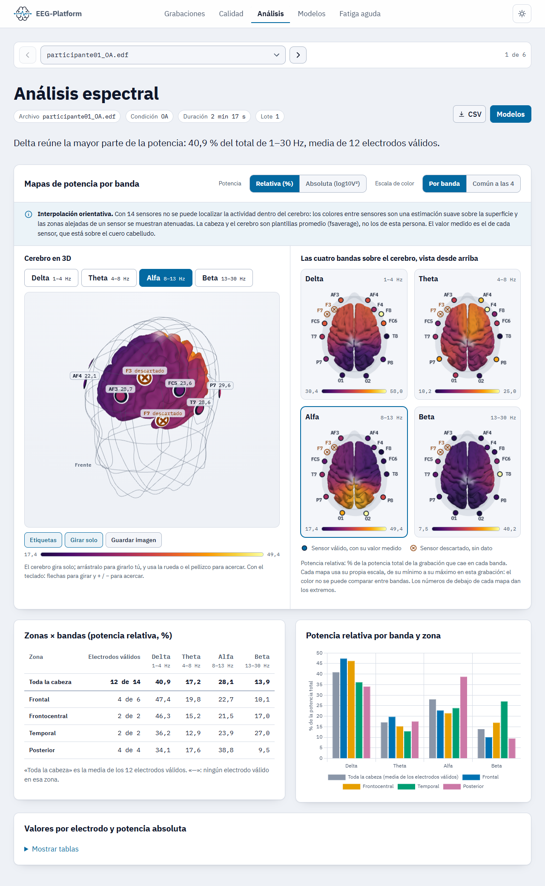

# EEG-Platform

Aplicación web, de uso **local** en Windows, para que investigadores de Ciencias del Deporte
procesen grabaciones EEG del casco **Emotiv EPOC X** (EDF, 14 canales) sin programar. Usa la
librería [EEG-Library](https://github.com/Miguelit011/EEG-Library) para todo el cálculo; la web sube, guarda y muestra.

Forma parte del Trabajo Fin de Grado de Miguel Ángel (Grado en Ingeniería Informática,
Ingeniería del Software, UEx).



Qué hace:

1. Subir uno o muchos EDF a la vez, con los parámetros de procesado (referencia, paso banda y notch).
2. Lista de grabaciones con su estado y el progreso del lote.
3. Calidad de la señal por grabación: mapa de electrodos sobre el cerebro y motivo de cada descarte.
4. Análisis espectral por grabación: potencia por banda y por zona, con una cabeza y un cerebro en 3D y cuatro mapas por banda (el color entre sensores es una interpolación orientativa, no localiza fuentes).
5. Una pestaña **Modelos** con lo que predicen los modelos de IA enchufables (hoy, c1, c2 y c3 del estudio) para cada grabación, junto a su resultado en el test independiente, con el intervalo y el nivel de azar, y un resumen de todas las grabaciones.
6. Una pestaña **Tiempo en tarea**, solo para PASAT y PVTB: cómo cambia el EEG a lo largo de la tarea según la regresión logística y la red EEGNet, con su veredicto en test y cuatro mapas del cerebro animados.
7. Descargar los resultados en CSV (una grabación o el lote completo).

Calidad, Análisis, Modelos y Tiempo en tarea son cuatro vistas de una misma grabación: la barra de navegación recuerda la última que abriste y un selector con flechas permite cambiar de grabación sin salir de la pestaña.

> **No detecta ni mide fatiga.** Los modelos clasifican la condición de la grabación (por
> ejemplo, reposo o tarea) y los resultados del TFG muestran que el EEG no predice la fatiga
> percibida. La pestaña Tiempo en tarea mide cómo cambia el EEG con el tiempo en la tarea, no
> el nivel de fatiga de la persona. Los resultados de los modelos se acompañan siempre de su
> acierto en un test independiente y de sus limitaciones.

## Antes de empezar

- **Windows 10 u 11** y conexión a internet **solo para instalar**; después funciona sin internet.
- **Python 3.10** (puede convivir con otras versiones). Descárgalo de
  <https://www.python.org/downloads/windows/> (instalador de 64 bits de la 3.10.x).
- **Una ruta corta.** Windows limita las rutas a 260 caracteres y alguna dependencia tiene archivos
  con rutas muy profundas: instala en algo como `C:\TFG` y no dentro de OneDrive ni de carpetas
  con nombres largos. `instalar.bat` lo comprueba al empezar.
- **Las dos carpetas juntas.** La plataforma instala EEG-Library desde la carpeta de al lado,
  así que los dos repositorios deben estar clonados en la misma carpeta:

  ```
  TFG\
  ├── EEG-Library\         librería de procesado
  ├── EEG-Platform\        esta aplicación
  └── EEG-Platform-datos\  se crea sola: base de datos, EDF subidos y resultados
  ```

## Instalar (una vez)

Haz doble clic en **`instalar.bat`**. Busca Python 3.10, crea el entorno, instala las
dependencias (la primera vez tarda unos minutos), crea la configuración y la base de datos y
comprueba que los modelos cargan. Si algo falla, te dice qué es.

<details>
<summary>Lo mismo, a mano, en PowerShell (desde la carpeta <code>EEG-Platform</code>)</summary>

```powershell
& "$env:LOCALAPPDATA\Programs\Python\Python310\python.exe" -m venv .venv
.venv\Scripts\python.exe -m pip install -r requirements.txt
copy .env.example .env
.venv\Scripts\python.exe manage.py migrate
```
</details>

## Usar

Haz doble clic en **`iniciar.bat`**. Se abren dos ventanas negras (la web y el procesador) y el
navegador en <http://127.0.0.1:8000/>. **Déjalas abiertas mientras trabajes; para terminar,
ciérralas.** Si la lista avisa de que el procesador no está en marcha, es que esa ventana se
cerró: vuelve a abrir `iniciar.bat`.

La guía paso a paso, con capturas, está en [`docs/GUIA_DE_USO.md`](docs/GUIA_DE_USO.md).

Si ya hay algo funcionando en el puerto 8000 (por ejemplo, la versión anterior sin cerrar),
`iniciar.bat` te pregunta si quieres **reiniciarla con la versión actual** (pulsa `S`) o solo abrir
el navegador (`N`). Reiniciar es seguro: lo que estaba en cola continúa donde iba.

## Actualizar a una versión nueva

1. **Cierra** las dos ventanas negras de la versión anterior («EEG-Platform - web» y
   «EEG-Platform - procesador»), o pulsa `S` cuando `iniciar.bat` te pregunte por ellas. Si no,
   sigues viendo la versión vieja.
2. Actualiza las carpetas (`EEG-Platform` y, si cambió, `EEG-Library`) con la versión nueva.
   Tus datos viven aparte, en `EEG-Platform-datos`, y no se tocan.
3. Abre **`instalar.bat`** otra vez (es seguro repetirlo: reutiliza el entorno y la configuración,
   instala lo que falte y aplica las migraciones de la base de datos).
4. Abre **`iniciar.bat`**.

La web no guarda en el navegador copias antiguas del CSS ni del JS, así que no hace falta limpiar
la caché ni pulsar Ctrl+F5.

## Dónde se guardan los datos

Los EDF y los resultados son de **participantes menores de edad**. Se guardan **fuera del
repositorio**, en la carpeta `EEG-Platform-datos` (o la que indiques en `EEG_PLATFORM_DATOS`
dentro de `.env`). La plataforma no arranca si se configura una carpeta dentro del repositorio.
Nunca se suben a git ni a servicios externos, y la web no usa recursos de internet.

## Para quien desarrolla

```powershell
.venv\Scripts\python.exe -m pytest                       # tests
.venv\Scripts\python.exe manage.py runserver             # solo la web
.venv\Scripts\python.exe manage.py procesar              # solo el procesador
.venv\Scripts\python.exe manage.py comprobar_modelos     # valida los modelos registrados
.venv\Scripts\python.exe manage.py documentar_csv        # regenera docs/COLUMNAS_CSV.md
.venv\Scripts\python.exe docs\generar_capturas.py        # regenera las capturas de docs/capturas (datos anónimos)
.venv\Scripts\python.exe docs\generar_mallas.py --pial-izq <pial_left.gii.gz> --pial-der <pial_right.gii.gz>   # regenera static/models (ver su docstring)
```

## Documentación

| Documento | Para qué |
|---|---|
| [`docs/GUIA_DE_USO.md`](docs/GUIA_DE_USO.md) | Cómo usar la plataforma, con capturas |
| [`docs/COLUMNAS_CSV.md`](docs/COLUMNAS_CSV.md) | Qué significa cada columna del CSV |
| [`docs/AÑADIR_UN_MODELO.md`](docs/AÑADIR_UN_MODELO.md) | Cómo añadir un modelo nuevo |
| [`docs/DECISIONES.md`](docs/DECISIONES.md) | Decisiones de diseño y su porqué |
| [`docs/MATERIAL_MEMORIA.md`](docs/MATERIAL_MEMORIA.md) | Arquitectura, casos de uso, tests y capturas para la memoria |
| [`docs/PRUEBA_LOTE_REAL.md`](docs/PRUEBA_LOTE_REAL.md) | Prueba completa con un lote de EDF reales |
| [`docs/diseno/`](docs/diseno/) | Críticas de diseño de la interfaz (registro de la Fase 9, generadas con una herramienta de revisión) |
| [`PLAN.md`](PLAN.md) | Plan de desarrollo por fases |

## Licencia

MIT. Ver [`LICENSE`](LICENSE). Los recursos de terceros de `static/` (Chart.js, Three.js, fuentes IBM Plex y mallas de cabeza y cerebro) conservan su propia licencia, que acompaña a cada uno.
