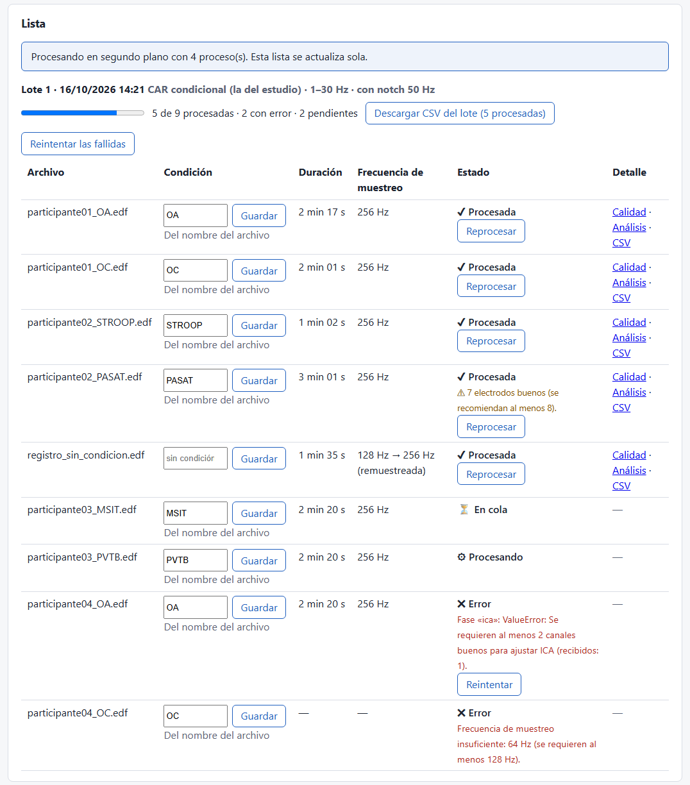
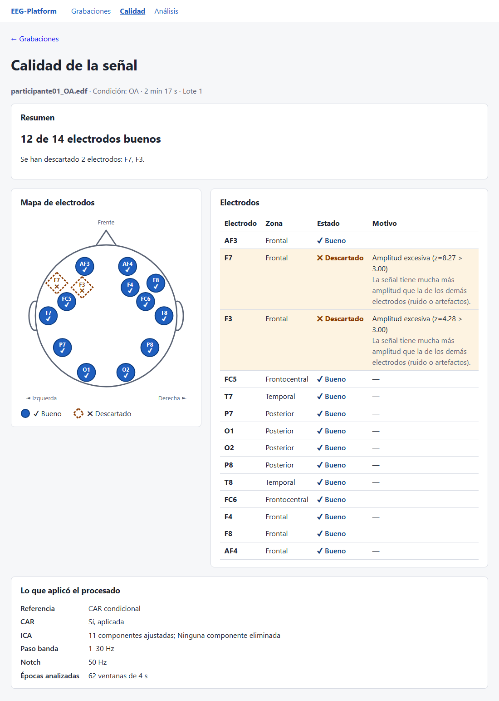
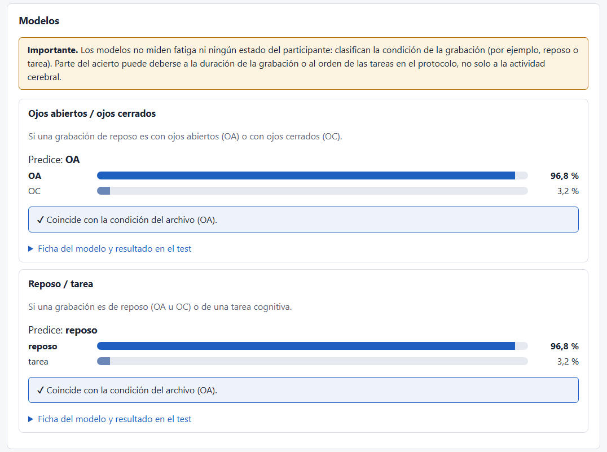
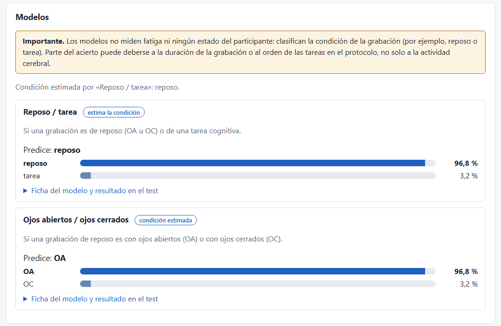

# Guía de uso de EEG-Platform

Esta guía es para quien trabaja con grabaciones del casco Emotiv EPOC X y no necesita saber
programar. Las capturas usan **datos de ejemplo anónimos**, no grabaciones reales.

## Qué hace y qué no hace

EEG-Platform procesa grabaciones EEG (archivos EDF), te enseña **cómo de buena es la señal** de
cada una, **cuánta potencia hay en cada banda** (delta, theta, alfa y beta) y deja descargar
los resultados en CSV para analizarlos en Excel o SPSS.

> **No detecta ni mide fatiga.** Los resultados de este trabajo muestran que el EEG no predice
> la fatiga percibida. Los modelos de IA que incluye solo clasifican **la condición de la
> grabación** (por ejemplo, reposo con ojos abiertos o cerrados, o cuál de cinco tareas) y
> siempre se muestran junto a lo bien o mal que funcionan.

## 1. Poner en marcha la plataforma

Haz doble clic en **`iniciar.bat`** (en la carpeta `EEG-Platform`). Se abren **dos ventanas
negras** —«EEG-Platform - web» y «EEG-Platform - procesador»— y, unos segundos después, el
navegador con la plataforma. Si es la primera vez, antes hay que ejecutar `instalar.bat` (lo
explica el [README](../README.md)).

- **Déjalas abiertas mientras trabajes.** La web enseña los resultados y el procesador los
  calcula; sin el procesador, las grabaciones se quedan «en cola» y no avanzan.
- **Para terminar, cierra las dos ventanas.**
- No hace falta internet: todo funciona en tu ordenador y los datos no salen de él.

## 2. Subir grabaciones

1. **Arrastra los archivos EDF** a la zona punteada (o pulsa para elegirlos). Puedes subir uno o
   cientos a la vez: forman un **lote**.
2. **Elige los parámetros de procesado**, que valen para todo el lote:

   | Parámetro | Qué es | Cuándo cambiarlo |
   |---|---|---|
   | **Referencia** | *CAR condicional* promedia los electrodos buenos y lo resta a cada uno (la del estudio). *Original* deja la referencia del casco | Normalmente, no |
   | **Paso banda** | Qué frecuencias se conservan: 1–30 Hz (la del estudio) o 3–30 Hz | Con 3–30 Hz la banda delta casi desaparece por el propio filtro |
   | **Filtro notch a 50 Hz** | Quita la interferencia de la red eléctrica | Normalmente, no |

   Por defecto están los parámetros **con los que se entrenaron los modelos**. Con otros, la
   plataforma procesa igual, pero **los modelos no darán predicciones**: solo valen con el
   procesado con el que se entrenaron.
3. Pulsa **Subir**.

**Qué se comprueba al subir.** Cada archivo se revisa por separado y uno malo no estropea el
resto del lote. Se rechaza un archivo si no se puede leer como EDF, si tiene menos de 128 Hz de
frecuencia de muestreo, si le faltan alguno de los 14 electrodos del Emotiv o si dura menos de
14 segundos. Un archivo de 128 Hz se acepta y se remuestrea a 256 Hz (la lista lo indica).

## 3. La lista de grabaciones

Cada lote tiene su cabecera con los parámetros usados, una barra de progreso y el botón para
descargar su CSV. En cada grabación ves:

| Estado | Significa |
|---|---|
| ⏳ **En cola** | Espera su turno |
| ⚙ **Procesando** | El procesador la está analizando |
| ✔ **Procesada** | Lista: puedes ver su calidad, su análisis y descargar su CSV |
| ✖ **Error** | No se pudo procesar. El mensaje dice por qué |

La lista **se actualiza sola** cada pocos segundos mientras haya algo pendiente.

- **La condición** (OA, OC, STROOP, PASAT…) se lee del nombre del archivo. Es opcional: si no se
  reconoce queda vacía y la plataforma funciona igual. Puedes escribirla o corregirla en la
  casilla y pulsar **Guardar**.
- **Reintentar / Reprocesar.** *Reintentar* vuelve a poner en cola una grabación que falló, y
  *Reintentar las fallidas* lo hace con todas las del lote. *Reprocesar* repite una ya procesada
  (el resultado anterior se conserva hasta que termine el nuevo). Un archivo rechazado al subir
  no se puede reintentar: hay que volver a subirlo, corregido.
- **El aviso ⚠ «N electrodos buenos».** Si una grabación tiene menos de 8 electrodos buenos, la
  lista lo avisa («se recomiendan al menos 8»); con menos de 6, dice que los **resultados no son
  fiables**. La grabación se procesa igualmente: es un aviso, no un bloqueo.

### Si la lista no avanza

Si hay grabaciones en cola y el procesador no da señales, la lista lo dice en un aviso naranja.
Casi siempre es que se cerró su ventana: **abre `iniciar.bat` otra vez** y continuará donde iba.

## 4. Calidad de la señal

Desde la lista, pulsa **Calidad** en una grabación procesada.

- **Resumen:** cuántos de los 14 electrodos son buenos y cuáles se han descartado.
- **Mapa de electrodos** (cabeza vista desde arriba, nariz hacia arriba). El estado **no depende
  solo del color**: un círculo azul con ✔ es un electrodo bueno; un rombo discontinuo con ✖ es
  un electrodo descartado.
- **Tabla** con la zona de cada electrodo y, si se descartó, el **motivo**: mal contacto
  (calidad de contacto baja del casco), señal plana (sin señal) o amplitud excesiva (ruido o
  artefactos).
- **Lo que aplicó el procesado:** si se usó la CAR (y por qué no, si se omitió), cuántas
  componentes de ICA se eliminaron por ser artefactos oculares, el paso banda y el número de
  ventanas analizadas.

Un electrodo descartado **no cuenta** en ningún resultado: se deja fuera de las medias, de los
mapas y del CSV.

## 5. Análisis espectral

Pulsa **Análisis** en una grabación procesada.

- **Gráfica y tabla:** el porcentaje de la potencia total (de 1 a 30 Hz) que cae en cada banda,
  para **toda la cabeza** (media de los electrodos válidos) y para cada **zona** (frontal,
  frontocentral, temporal y posterior). «—» significa que esa zona no tiene ningún electrodo
  válido.
- **Mapa de la cabeza por banda:**

  

  Elige la banda con los botones. Cada círculo es un electrodo y lleva escrito **su porcentaje**.
  El color va del valor mínimo al máximo **de esa banda en esa grabación**, así que **no se puede
  comparar el color entre bandas**; la leyenda da los valores de los extremos. No hay
  interpolación: no se inventan valores entre electrodos. Los rombos son electrodos descartados,
  sin dato.
- **Tablas desplegables** con la potencia relativa y absoluta (log10 de V²) por
  electrodo y por zona.

## 6. Modelos de IA

Debajo del mapa, el bloque **Modelos** muestra qué predicen los modelos para esa grabación.

Hoy hay tres, entrenados con las grabaciones del estudio y evaluados **una sola vez** en un test
independiente de 28 personas:

| Modelo | Qué predice | Acierto en el test (IC 95 %) | Azar |
|---|---|---|---|
| **c1** | Ojos abiertos u ojos cerrados (reposo) | 0,855 (0,794–0,912) | 0,50 |
| **c2** | Reposo o tarea | 0,851 (0,813–0,885) | 0,50 |
| **c3** | Cuál de las 5 tareas (STROOP, PASAT, PVTB, MSIT, PVSAT) | 0,488 (0,441–0,531) | 0,20 |

*(Exactitud balanceada. El nivel de azar es lo que acertaría quien adivinase.)*

Cómo leer cada tarjeta:

- **Predice:** la clase más probable, y debajo **la probabilidad de todas las clases**.
- **Con la condición del archivo conocida**, se compara con ella: ✔ si coincide o ⚠ si no. Si el
  modelo discrepa con mucha seguridad (80 % o más), el aviso lo destaca: conviene revisar la
  etiqueta o la grabación.
- **Con la condición desconocida**, el modelo reposo/tarea (c2) decide y se muestra, según el
  caso, c1 o c3, marcado como **«condición estimada»**:

  
- **«No disponible con estos parámetros»:** la grabación se procesó con otros parámetros que los
  del entrenamiento, y no se muestra ninguna predicción.
- **Ficha del modelo** (desplegable): el resultado en el test, a qué condiciones se aplica y sus
  limitaciones.

**Cómo no interpretarlos.** Estos modelos **no miden fatiga ni ningún estado del participante**.
c3, con un acierto de 0,49 sobre un azar de 0,20, acierta la tarea a menudo pero se equivoca en
la mitad de los casos. Y parte del acierto de todos puede deberse a la **duración** de la
grabación o al **orden** de las tareas en el protocolo, no solo a la actividad cerebral.

## 7. Descargar los resultados en CSV

- **De un lote:** botón **Descargar CSV del lote** en su cabecera (solo incluye las grabaciones
  ya procesadas).
- **De una grabación:** enlace **CSV** en la lista, o el botón de la pantalla de análisis.

El archivo tiene **una fila por grabación** y está preparado para **Excel en español**: columnas
separadas por `;`, decimales con coma y tildes correctas. Ábrelo con doble clic. Qué significa cada
columna: [`COLUMNAS_CSV.md`](COLUMNAS_CSV.md). Algunas claves:

- Una **celda vacía** significa «sin dato» (electrodo descartado, zona sin electrodos válidos…),
  nunca un cero.
- La potencia **relativa** va de 0 a 1 (no en %); la **absoluta**, en log10 de V².
- Las columnas de los modelos están al final (`c1_oa_oc_logistica_clase`, sus probabilidades…).

**En SPSS:** importa el archivo como datos de texto (*Archivo → Importar datos*; los menús varían
según la versión) y marca el separador `;` y la coma como decimal. Si en tu equipo SPSS usa otra configuración regional, el formato internacional
(separador `,` y decimal `.`) se cambia en `config/settings.py` (`CSV_SEPARADOR`, `CSV_DECIMAL`).

## 8. Añadir un modelo nuevo

Un modelo nuevo se añade con **dos archivos y una línea de configuración**, sin tocar el código:
[`AÑADIR_UN_MODELO.md`](AÑADIR_UN_MODELO.md) lo explica paso a paso y el comando
`manage.py comprobar_modelos` revisa que esté bien.

## 9. Problemas frecuentes

| Qué pasa | Qué hacer |
|---|---|
| La lista no avanza y sale un aviso naranja | El procesador está parado: abre `iniciar.bat` de nuevo |
| `iniciar.bat` dice que el puerto 8000 está ocupado | Ya está en marcha (se abre el navegador) o hay otro programa usando ese puerto |
| Un archivo sale con error al subirlo | Lee el mensaje: formato, frecuencia menor de 128 Hz, faltan electrodos o dura menos de 14 s |
| Una grabación sale con «Fase «ica»… al menos 2 canales buenos» | Casi todos sus electrodos están descartados: la grabación no es aprovechable |
| Excel abre el CSV con todo en una sola columna | Tu Excel usa otro separador: *Datos → Obtener datos → Desde texto/CSV* y elige `;` |
| «No disponible con estos parámetros» en los modelos | Se procesó con parámetros distintos a los del entrenamiento (ver apartado 2) |
| `instalar.bat` dice que la carpeta está demasiado anidada | Mueve la carpeta TFG a una ruta corta, como `C:\TFG` (Windows limita las rutas a 260 caracteres) |
| No sale nada tras abrir `iniciar.bat` | Espera unos segundos; si no, abre `http://127.0.0.1:8000/` a mano |

## 10. Privacidad

Los EDF y los resultados son de **participantes menores de edad**. Se guardan en la carpeta
`EEG-Platform-datos`, **fuera del repositorio**, y no se envían a ningún servicio externo. No los
copies a git ni compartas capturas o CSV con datos reales sin permiso.
