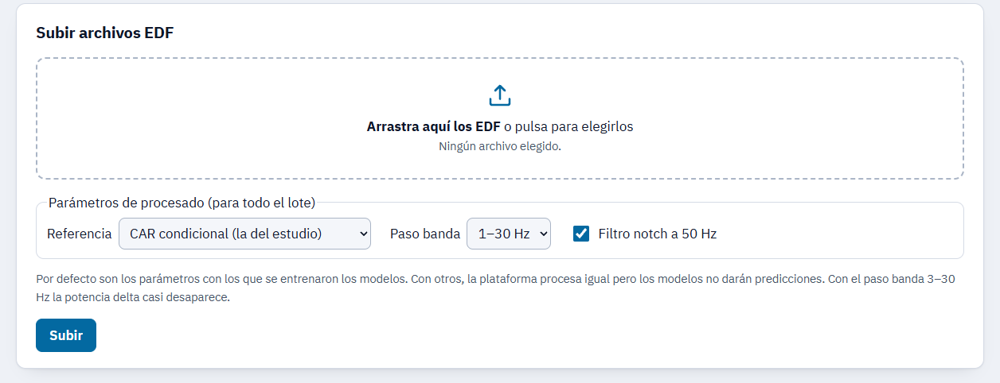
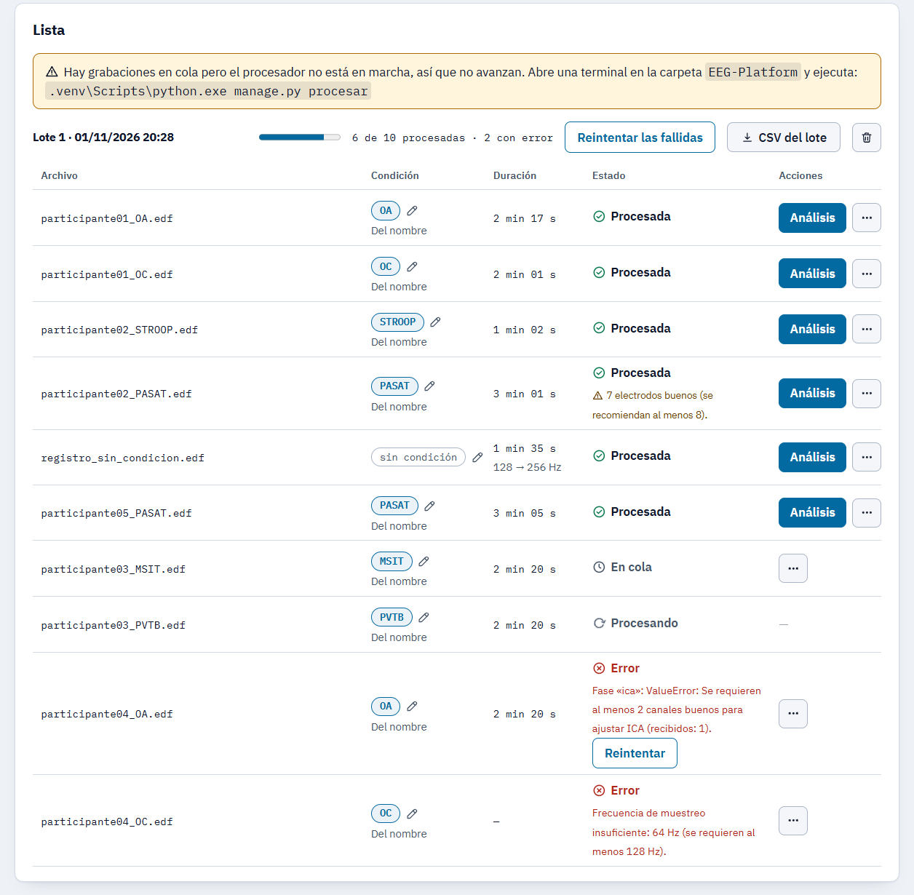
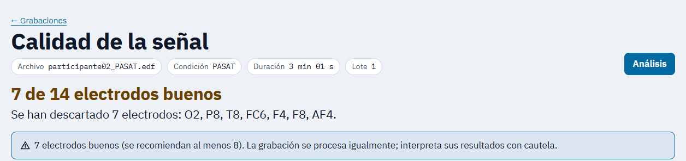
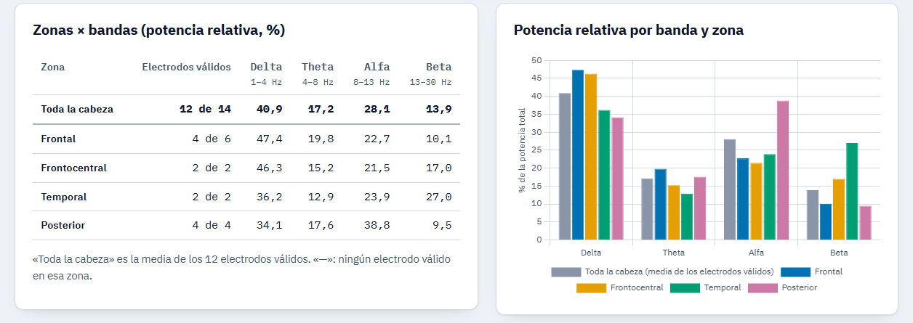
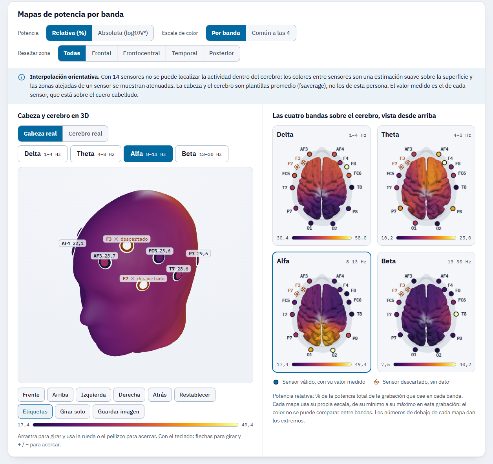
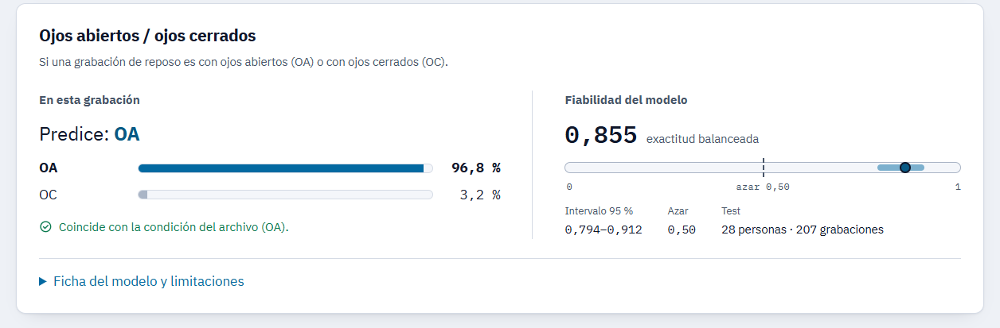
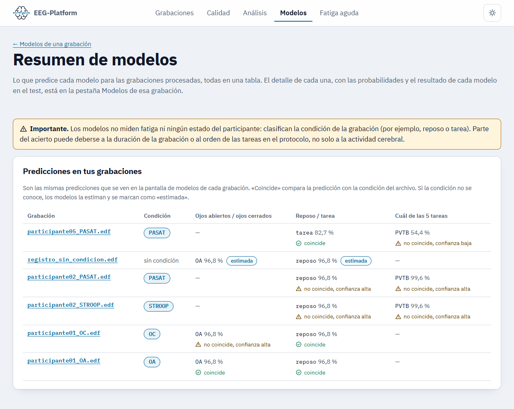
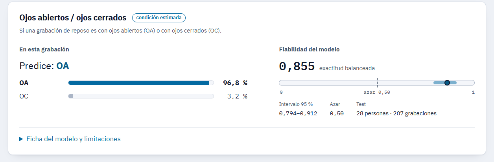
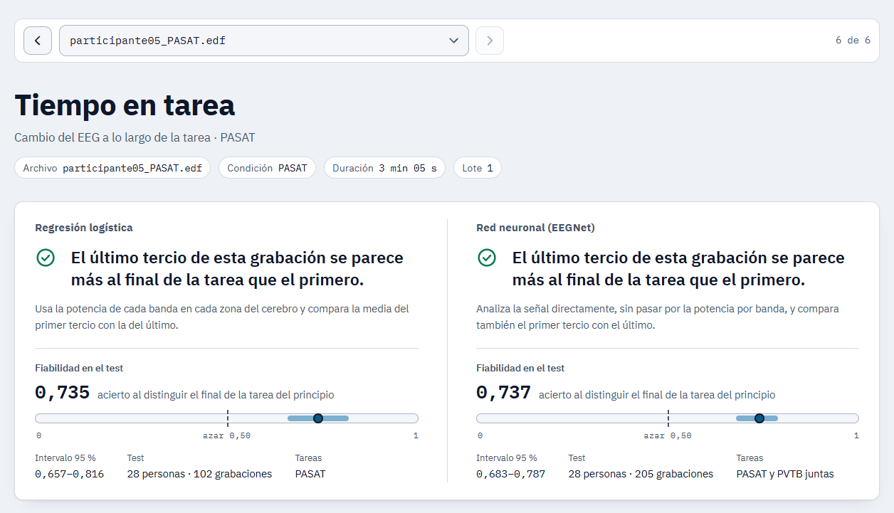
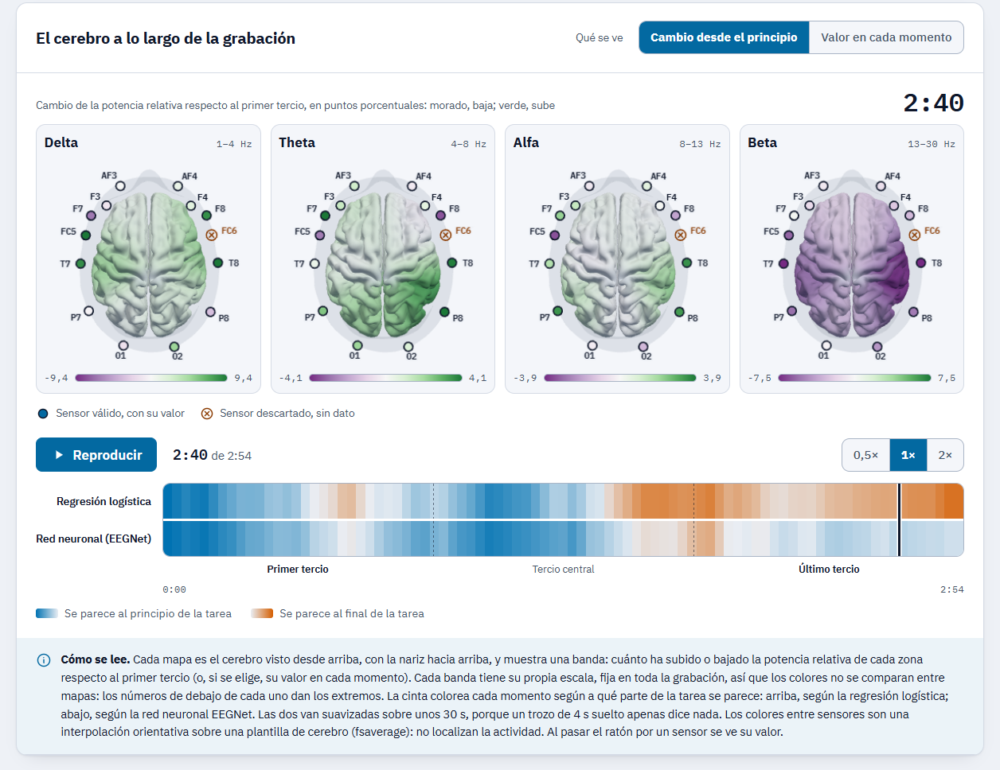

# Guía de uso de EEG-Platform

Esta guía es para quien trabaja con grabaciones del casco Emotiv EPOC X y no necesita saber
programar. Las capturas usan **datos de ejemplo anónimos**, no grabaciones reales.

## Qué hace y qué no hace

EEG-Platform procesa grabaciones EEG (archivos EDF), te enseña **cómo de buena es la señal** de
cada una, **cuánta potencia hay en cada banda** (delta, theta, alfa y beta) y deja descargar
los resultados en CSV para analizarlos en Excel o SPSS.

> **No detecta ni mide fatiga.** Los resultados de este trabajo muestran que el EEG no predice
> la fatiga percibida. Los modelos de IA que incluye solo clasifican **la condición de la
> grabación** (por ejemplo, reposo con ojos abiertos o cerrados, o cuál de cinco tareas) y
> siempre se muestran junto a lo bien o mal que funcionan.
>
> La pestaña **Tiempo en tarea** enseña **cómo cambia el EEG a lo largo de una tarea larga**
> (PASAT o PVTB). Ese cambio puede deberse a muchas cosas (cansancio, habituación a la tarea,
> pérdida de atención o el asentamiento del casco): no mide el nivel de fatiga de la persona
> (sección 7).

## 1. Poner en marcha la plataforma

En la carpeta `EEG-Platform`, abre el **lanzador** de tu sistema:

- **Windows:** doble clic en **`iniciar.bat`**. Se abren **dos ventanas negras** —«EEG-Platform -
  web» y «EEG-Platform - procesador»— y, unos segundos después, el navegador con la plataforma.
- **macOS:** doble clic en **`iniciar.command`**. Se abre **una ventana de Terminal** con la web y
  el procesador y, unos segundos después, el navegador.
- **Linux:** en una terminal, dentro de la carpeta, **`bash iniciar.sh`**. La web y el procesador
  funcionan en esa terminal y se abre el navegador.

Si es la primera vez, antes hay que instalar con `instalar.bat`, `instalar.command` o
`bash instalar.sh` (lo explica el [README](../README.md)).

- **Deja abiertas esas ventanas mientras trabajes.** La web enseña los resultados y el procesador
  los calcula; sin el procesador, las grabaciones se quedan «en cola» y no avanzan.
- **Para terminar, ciérralas** (en macOS y Linux también vale Ctrl+C en la terminal).
- No hace falta internet: todo funciona en tu ordenador y los datos no salen de él.

## 2. Subir grabaciones

1. **Arrastra los archivos EDF** a la zona punteada (o pulsa para elegirlos). Puedes subir uno o
   cientos a la vez: forman un **lote**.
2. **Elige los parámetros de procesado**, que valen para todo el lote:

   | Parámetro | Qué es | Cuándo cambiarlo |
   |---|---|---|
   | **Referencia** | *CAR condicional* promedia los electrodos buenos y lo resta a cada uno (la del estudio). *Original* deja la referencia del casco | Normalmente, no |
   | **Paso banda** | Qué frecuencias se conservan: 1–30 Hz (la del estudio) o 3–30 Hz | Con 3–30 Hz la banda delta casi desaparece por el propio filtro |
   | **Filtro notch a 50 Hz** | Quita la interferencia de la red eléctrica | Normalmente, no |

   Por defecto están los parámetros **con los que se entrenaron los modelos**. Con otros, la
   plataforma procesa igual, pero **los modelos no darán predicciones**: solo valen con el
   procesado con el que se entrenaron.
3. Pulsa **Subir**.

**Qué se comprueba al subir.** Cada archivo se revisa por separado y uno malo no estropea el
resto del lote. Se rechaza un archivo si no se puede leer como EDF, si tiene menos de 128 Hz de
frecuencia de muestreo, si le faltan alguno de los 14 electrodos del Emotiv o si dura menos de
14 segundos. Un archivo de 128 Hz se acepta y se remuestrea a 256 Hz (la lista lo indica).

## Moverse por la plataforma

La barra de arriba tiene cinco pestañas: **Grabaciones** (la lista), y **Calidad**, **Análisis**,
**Modelos** y **Tiempo en tarea**, que son cuatro vistas de **una misma grabación**. Para que la barra
baste para navegar:

- Las cuatro pestañas están **siempre activas** y llevan a la **grabación activa**: la que estabas
  viendo o, si no has abierto ninguna, la última procesada.
- Dentro de una de esas pestañas, una barra bajo el menú muestra la grabación activa. Pulsa su
  nombre para abrir un **selector** con todas las grabaciones procesadas, agrupadas por lote y con
  su condición, y un **buscador** para encontrar una escribiendo parte del nombre o de la
  condición (por ejemplo, «OA»). También puedes usar las **flechas** de anterior y siguiente.
  Cambias de grabación **sin salir de la pestaña**: por ejemplo, para revisar la calidad de todo
  un lote.
- Si todavía no hay ninguna grabación procesada, las pestañas lo explican y te llevan a subirlas.

## 3. La lista de grabaciones

Cada lote tiene su cabecera con los parámetros usados, una barra de progreso y el botón para
descargar su CSV. En cada grabación ves:

| Estado | Significa |
|---|---|
| ⏳ **En cola** | Espera su turno |
| ⚙ **Procesando** | El procesador la está analizando |
| ✔ **Procesada** | Lista: puedes ver su calidad, su análisis y descargar su CSV |
| ✖ **Error** | No se pudo procesar. El mensaje dice por qué |

La lista **se actualiza sola** cada pocos segundos mientras haya algo pendiente.

- **La condición** (OA, OC, STROOP, PASAT…) se lee del nombre del archivo. Es opcional: si no se
  reconoce queda vacía y la plataforma funciona igual. Para escribirla o corregirla, pulsa el
  lápiz que hay junto a la condición y **Guardar**.
- **Acciones de cada fila.** **Análisis** abre el análisis de la grabación. El botón **···**
  lleva a la **Calidad**, al **CSV** de esa grabación y a **Reprocesar**.
- **Reintentar / Reprocesar.** *Reintentar* vuelve a poner en cola una grabación que falló, y
  *Reintentar las fallidas* lo hace con todas las del lote. *Reprocesar* repite una ya procesada
  (el resultado anterior se conserva hasta que termine el nuevo). Un archivo rechazado al subir
  no se puede reintentar: hay que volver a subirlo, corregido.
- **Eliminar grabaciones y lotes.** En el menú **···** de cada fila está **Eliminar…**, y en la cabecera
  de cada lote hay un botón con una papelera. Antes de borrar se muestra una pantalla que lo explica y
  ofrece **Descargar el CSV antes**. Se elimina **de la plataforma**: el registro con sus resultados y
  la copia del EDF que la plataforma guardó. **El archivo original que subiste no se toca**: la
  plataforma solo trabaja con una copia. No se puede borrar lo que se está procesando; hay que esperar a
  que termine. Borrar no se puede deshacer: para volver a verlo hay que subir de nuevo el archivo.
- **El aviso ⚠ «N electrodos buenos».** Si una grabación tiene menos de 8 electrodos buenos, la
  lista lo avisa («se recomiendan al menos 8»); con menos de 6, dice que los **resultados no son
  fiables**. La grabación se procesa igualmente: es un aviso, no un bloqueo.

### Si la lista no avanza

Si hay grabaciones en cola y el procesador no da señales, la lista lo dice en un aviso naranja.
Casi siempre es que se cerró su ventana: **abre el lanzador otra vez** (`iniciar.bat`,
`iniciar.command` o `iniciar.sh`; el aviso dice cuál) y continuará donde iba.

## 4. Calidad de la señal

Desde la lista, pulsa **Calidad** en una grabación procesada.

- **Resumen:** cuántos de los 14 electrodos son buenos y cuáles se han descartado.
- **Mapa de electrodos** (el cerebro de una plantilla vista desde arriba, nariz hacia arriba, con
  los electrodos sobre la cabeza). El estado **no depende solo del color**: un círculo azul con
  una marca de verificación es un electrodo bueno; un círculo con una cruz dentro
  es un electrodo descartado.
- **Tabla** con la zona de cada electrodo y, si se descartó, el **motivo**: mal contacto
  (calidad de contacto baja del casco), señal plana (sin señal) o amplitud excesiva (ruido o
  artefactos).
- **Lo que aplicó el procesado:** si se usó la CAR (y por qué no, si se omitió), cuántas
  componentes de ICA se eliminaron por ser artefactos oculares, el paso banda y el número de
  ventanas analizadas.

Un electrodo descartado **no cuenta** en ningún resultado: se deja fuera de las medias, de los
mapas y del CSV.

## 5. Análisis espectral

Pulsa **Análisis** en una grabación procesada.

- **Gráfica y tabla:** el porcentaje de la potencia total (de 1 a 30 Hz) que cae en cada banda,
  para **toda la cabeza** (media de los electrodos válidos) y para cada **zona** (frontal,
  frontocentral, temporal y posterior). «—» significa que esa zona no tiene ningún electrodo
  válido.
- **Mapas de potencia por banda:**

  

  A la izquierda, un **cerebro en 3D** dentro de la silueta de la cabeza, que **gira solo** (se
  detiene al arrastrarlo; también se gira con el ratón o las flechas del teclado, y «Girar solo»
  lo reactiva); a la derecha, **los cuatro mapas** (delta, theta, alfa y beta) con el cerebro
  visto desde arriba. Pulsa una banda para verla en el 3D. Puedes elegir potencia **relativa**
  (porcentaje) o **absoluta** (log10 de V²), y escala **por banda** o **común a las
  cuatro**. Al pasar el ratón por un electrodo aparece su **valor medido**; los círculos
  con una cruz son electrodos descartados, sin dato. «Guardar imagen» descarga la vista 3D con el
  aviso incluido.

  **Importante:** el color entre electrodos es una **interpolación orientativa**. Con 14 sensores
  no se puede saber dónde se origina la actividad dentro del cerebro, y la cabeza y el cerebro
  son plantillas promedio, no los de la persona grabada. Por eso las zonas alejadas de un sensor
  se muestran apagadas. Con la escala por banda, el color no se puede comparar entre bandas.
- **Tablas desplegables** con la potencia relativa y absoluta (log10 de V²) por
  electrodo y por zona.

## 6. Modelos de IA

La pestaña **Modelos** muestra lo que cada modelo ha predicho para **la grabación activa**:

Cada modelo es una tarjeta con **dos partes**: a la izquierda, **lo que predice para esta
grabación** (la clase y la probabilidad de cada clase) y, a la derecha, **lo fiable que es ese
modelo en general**, medido en un test independiente. La fiabilidad se ve sobre una escala de 0 a 1:
el **resultado** (el punto), su **intervalo de confianza del 95 %** (el tramo coloreado) y el **nivel
de azar** (la raya vertical); lo que importa es cuánto se separa el punto de la raya. Con el botón **Todas las grabaciones** se
abre un **resumen** con una tabla que reúne la predicción de cada modelo para todas las grabaciones
procesadas (las 100 más recientes), con un enlace a la pestaña Modelos de cada una:

Hoy hay tres, entrenados con las grabaciones del estudio y evaluados **una sola vez** en un test
independiente de 28 personas:

| Modelo | Qué predice | Acierto en el test (IC 95 %) | Azar |
|---|---|---|---|
| **c1** | Ojos abiertos u ojos cerrados (reposo) | 0,855 (0,794–0,912) | 0,50 |
| **c2** | Reposo o tarea | 0,851 (0,813–0,885) | 0,50 |
| **c3** | Cuál de las 5 tareas (STROOP, PASAT, PVTB, MSIT, PVSAT) | 0,488 (0,441–0,531) | 0,20 |

*(Exactitud balanceada. El nivel de azar es lo que acertaría quien adivinase.)*

Cómo leer cada tarjeta:

- **Predice** (parte izquierda): la clase más probable, y debajo **la probabilidad de todas las
  clases**.
- **Con la condición del archivo conocida**, se compara con ella: «coincide» (en verde) o «no
  coincide». Si el modelo discrepa con mucha seguridad (80 % o más), el aviso se destaca en un
  recuadro: conviene revisar la etiqueta o la grabación.
- **Con la condición desconocida**, el modelo reposo/tarea (c2) decide y se muestra, según el
  caso, c1 o c3, marcado como **«condición estimada»**:

  
- **«No disponible con estos parámetros»:** la grabación se procesó con otros parámetros que los
  del entrenamiento, y no se muestra ninguna predicción.
- **Ficha del modelo y limitaciones** (desplegable): las clases, a qué condiciones se aplica, con
  qué procesado es válido, cuándo se entrenó, de dónde salen las cifras y sus limitaciones.

**Cómo no interpretarlos.** Estos modelos **no miden fatiga ni ningún estado del participante**.
c3, con un acierto de 0,49 sobre un azar de 0,20, acierta la tarea a menudo pero se equivoca en
la mitad de los casos. Y parte del acierto de todos puede deberse a la **duración** de la
grabación o al **orden** de las tareas en el protocolo, no solo a la actividad cerebral.

## 7. Tiempo en tarea

La pestaña **Tiempo en tarea** enseña **cómo cambia el EEG a lo largo de una tarea larga**. Solo
funciona con grabaciones **PASAT** y **PVTB**: el estudio confirmó en personas que no había visto
antes que, en esas dos tareas, el EEG cambia de forma ordenada con el tiempo y que ese cambio no lo
explican el movimiento ni el contacto de los electrodos. Con otra condición (o sin condición), la
pestaña lo explica; si la condición está mal, se corrige en la lista.

No hay que hacer nada: al abrir una grabación PASAT o PVTB procesada aparece todo.

**Arriba, el resultado de cada modelo, uno al lado del otro.** Los dos comparan la media del
**primer tercio** de la grabación con la del **último** y dicen, en una frase, si el final se
parece más al final de la tarea que el principio:

- **Regresión logística**, que usa la potencia de cada banda en cada zona. En el test
  independiente de 28 personas acertó en el **74 %** de las grabaciones PASAT y en el **83 %** de
  las PVTB (azar: 50 %).
- **Red neuronal (EEGNet)**, que analiza la señal directamente. Acertó en el **74 %** de las
  grabaciones PASAT y PVTB juntas (el test no dio la cifra por tarea). En el test no se distingue
  de la logística, así que lo esperable es que lleguen a la misma conclusión.

Debajo de cada frase, su fiabilidad en el test con el intervalo y el nivel de azar.

**En el centro, la grabación reproducida.** Con **Reproducir**, la grabación entera pasa en unos
20 segundos (0,5× y 2× la hacen más lenta o más rápida):

- **Cuatro mapas**, uno por banda (delta, theta, alfa y beta), con el cerebro visto desde arriba,
  muestran cuánto **sube (verde)** o **baja (morado)** la potencia de cada zona respecto al primer
  tercio. Con **Valor en cada momento** se ve el porcentaje de la potencia en cada banda. Cada mapa
  tiene su propia escala, fija en toda la grabación: los colores no se comparan entre bandas.
- La **cinta** de debajo colorea cada momento según a qué parte de la tarea se parece: **azul**, al
  principio; **naranja**, al final. Tiene dos pistas: la de arriba es la de la **regresión
  logística** y la de abajo, la de la **red neuronal EEGNet**. Se puede pinchar o arrastrar para ir a un momento, y con el
  teclado, las flechas avanzan o retroceden y la barra espaciadora reproduce o pausa.
- Las dos van **suavizadas** sobre unos 30 s: un trozo de 4 s suelto apenas dice nada.

**Cómo no interpretarla.** Mide el **cambio con el tiempo en tarea**, no el nivel de fatiga de la
persona ni lo cansada que dice estar. Parte del cambio puede deberse a que el casco se asienta (en
reposo también aparece algo), y el orden de las tareas del protocolo es siempre el mismo. Si una
grabación se procesó con una versión anterior de la plataforma, la pestaña pide **volver a
procesarla** (si es anterior solo a la red neuronal, se ve la logística y el apartado de EEGNet
avisa de que falta, con su botón para volver a procesarla).

## 8. Descargar los resultados en CSV

- **De un lote:** botón **CSV del lote** (con la flecha de descarga) en su cabecera (solo incluye las grabaciones
  ya procesadas).
- **De una grabación:** opción **CSV** del menú ··· de la lista, o el botón **CSV** (con la flecha de descarga) de la pantalla de análisis.

El archivo tiene **una fila por grabación** y está preparado para **Excel en español**: columnas
separadas por `;`, decimales con coma y tildes correctas. Ábrelo con doble clic. Qué significa cada
columna: [`COLUMNAS_CSV.md`](COLUMNAS_CSV.md). Algunas claves:

- Una **celda vacía** significa «sin dato» (electrodo descartado, zona sin electrodos válidos…),
  nunca un cero.
- La potencia **relativa** va de 0 a 1 (no en %); la **absoluta**, en log10 de V².
- Las columnas de los modelos están al final (`c1_oa_oc_logistica_clase`, sus probabilidades…),
  y detrás las seis de tiempo en tarea (`tiempo_en_tarea_rho`, `tiempo_en_tarea_final_mayor`… y las dos de
  EEGNet, `tiempo_en_tarea_eegnet_*`), que solo se rellenan en grabaciones PASAT y PVTB.

**En SPSS:** importa el archivo como datos de texto (*Archivo → Importar datos*; los menús varían
según la versión) y marca el separador `;` y la coma como decimal. Si en tu equipo SPSS usa otra configuración regional, el formato internacional
(separador `,` y decimal `.`) se cambia en `config/settings.py` (`CSV_SEPARADOR`, `CSV_DECIMAL`).

## 9. Añadir un modelo nuevo

Un modelo nuevo se añade con **dos archivos y una línea de configuración**, sin tocar el código:
[`AÑADIR_UN_MODELO.md`](AÑADIR_UN_MODELO.md) lo explica paso a paso y el comando
`manage.py comprobar_modelos` revisa que esté bien.

## 10. Problemas frecuentes

| Qué pasa | Qué hacer |
|---|---|
| La lista no avanza y sale un aviso naranja | El procesador está parado: abre el lanzador de nuevo (`iniciar.bat`, `iniciar.command` o `iniciar.sh`) |
| El lanzador dice que el puerto 8000 está ocupado | Ya está en marcha (pulsa `N` y se abre el navegador) o hay otro programa usando ese puerto |
| Un archivo sale con error al subirlo | Lee el mensaje: formato, frecuencia menor de 128 Hz, faltan electrodos o dura menos de 14 s |
| Una grabación sale con «Fase «ica»… al menos 2 canales buenos» | Casi todos sus electrodos están descartados: la grabación no es aprovechable |
| Excel abre el CSV con todo en una sola columna | Tu Excel usa otro separador: *Datos → Obtener datos → Desde texto/CSV* y elige `;` |
| «No disponible con estos parámetros» en los modelos | Se procesó con parámetros distintos a los del entrenamiento (ver apartado 2) |
| `instalar.bat` dice que la carpeta está demasiado anidada | Mueve la carpeta TFG a una ruta corta, como `C:\TFG` (Windows limita las rutas a 260 caracteres) |
| El instalador dice que no encuentra Python 3.10 | Instálalo como indica el mensaje (cambia según el sistema) y vuelve a abrir el instalador |
| macOS no deja abrir `iniciar.command` («desarrollador no identificado» o «procede de internet») | Clic derecho → **Abrir**; o, en **Ajustes del Sistema → Privacidad y seguridad**, **Abrir igualmente** |
| macOS dice que no tienes permiso para abrir `iniciar.command` | En Terminal, dentro de la carpeta `EEG-Platform`: `chmod +x *.command *.sh` (una sola vez) |
| No sale nada tras abrir el lanzador | Espera unos segundos; si no, abre `http://127.0.0.1:8000/` a mano |

## 11. Privacidad

Los EDF y los resultados son de **participantes menores de edad**. Se guardan en la carpeta
`EEG-Platform-datos`, **fuera del repositorio**, y no se envían a ningún servicio externo. Puedes eliminar de la plataforma cualquier grabación o lote (se borra también la copia
del EDF que guardó); tus archivos originales no se tocan. No los
copies a git ni compartas capturas o CSV con datos reales sin permiso.
