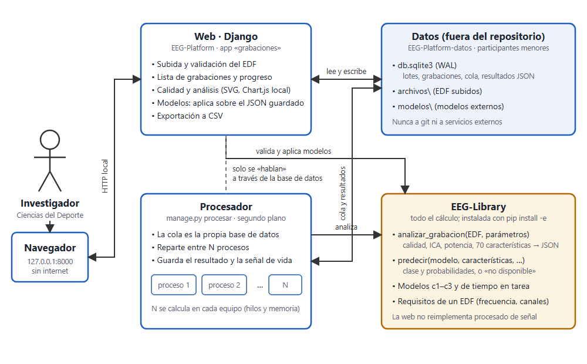
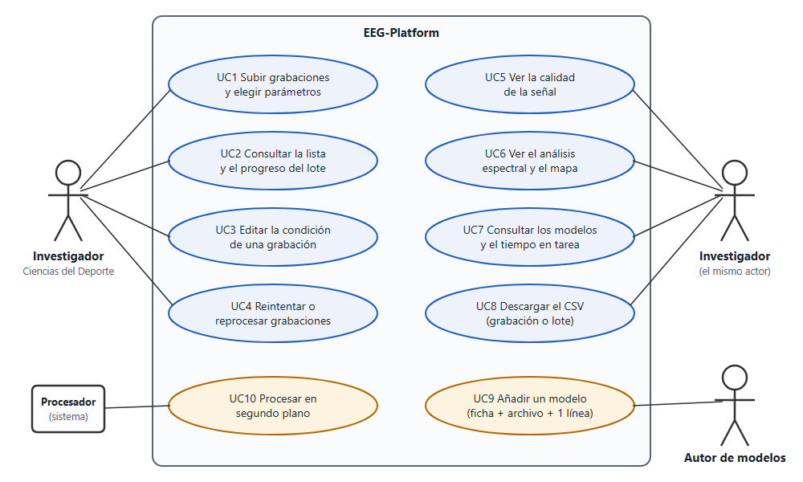
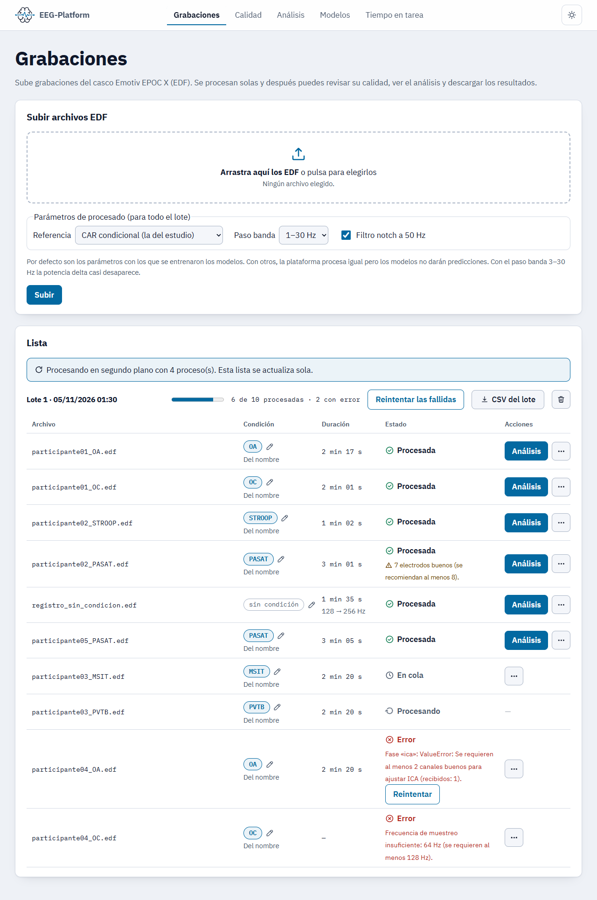
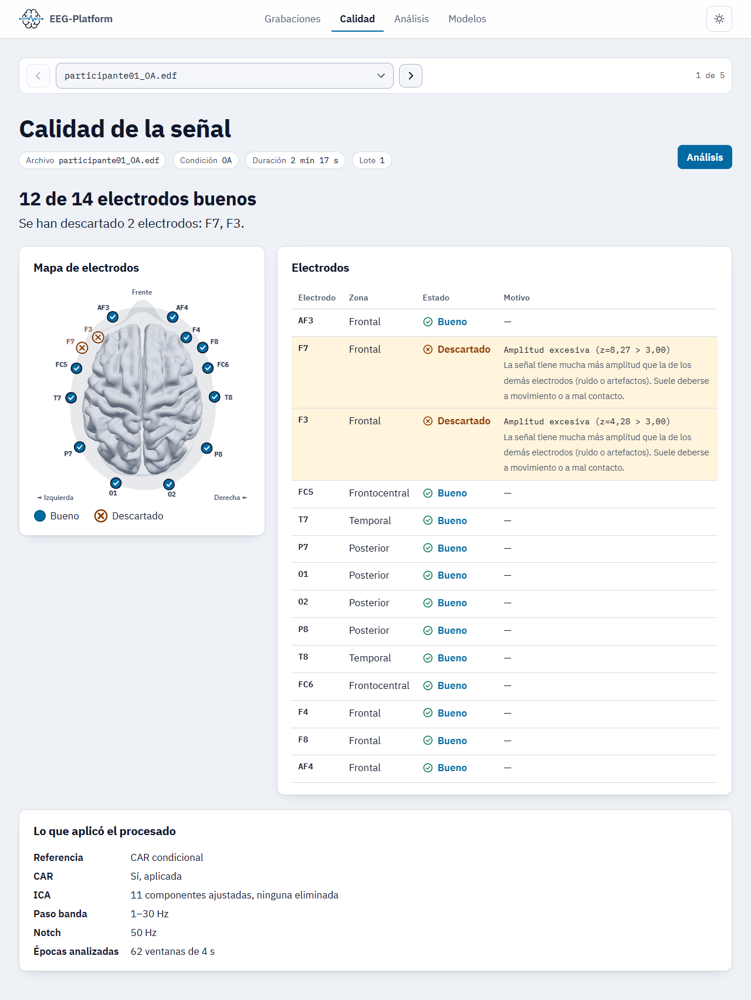
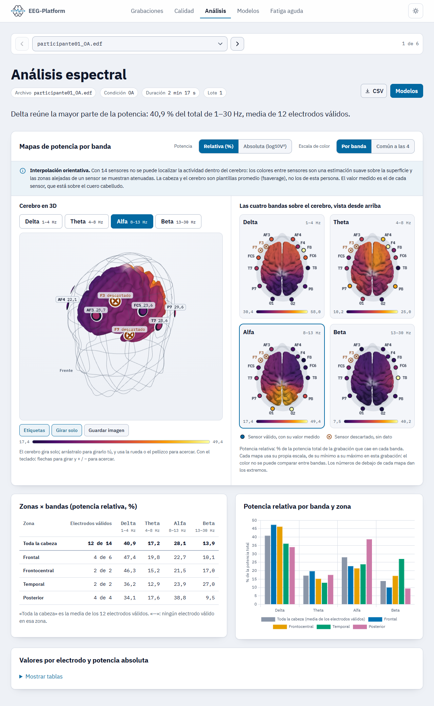
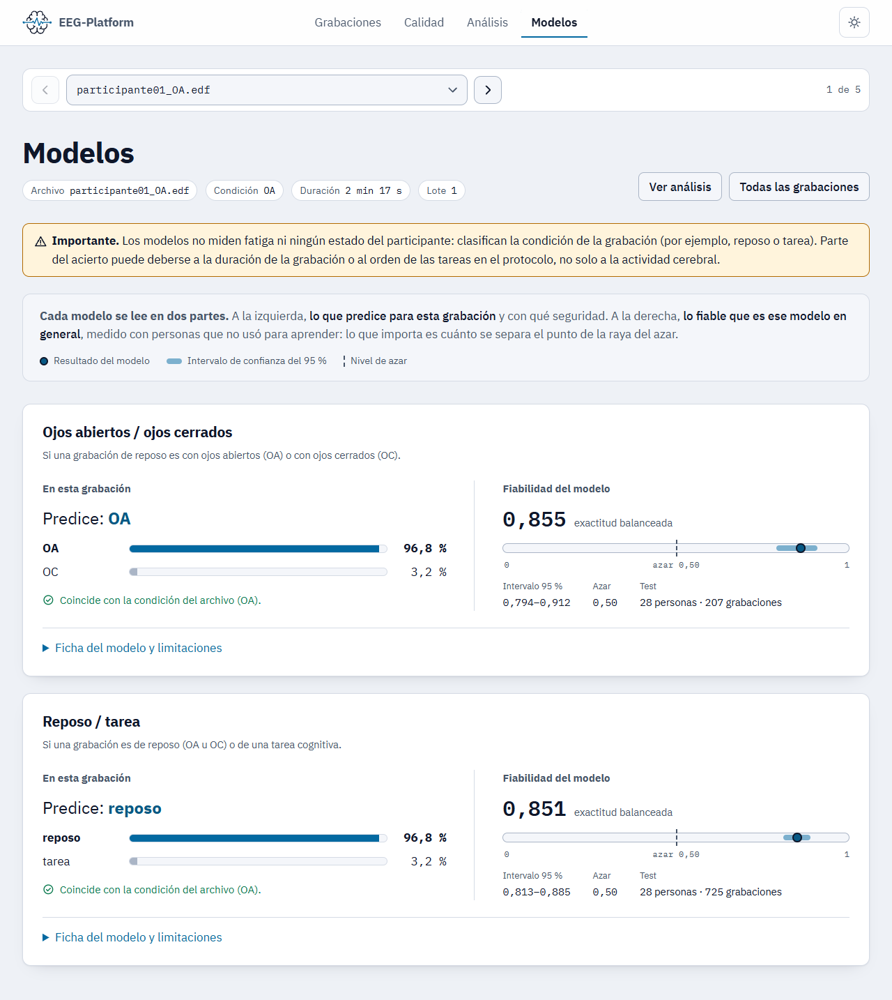
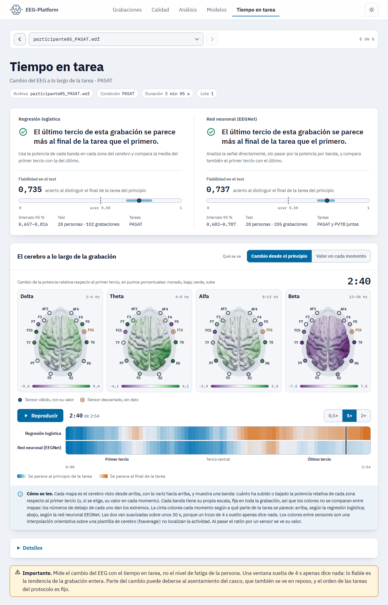

# Material para la memoria

Todo lo que hace falta para describir EEG-Platform en la memoria y en la defensa: arquitectura,
casos de uso, pantallas, pruebas y decisiones de diseño. Las figuras están en `docs/figuras/`
(SVG, para incluir sin pérdida, y PNG) y las capturas en `docs/capturas/`. No se ha modificado
EEG-Memoria: los textos de abajo están pensados para copiarlos o adaptarlos.

## 1. Qué es y qué problema resuelve

EEG-Library, que se desarrolló antes, procesa grabaciones del casco Emotiv EPOC X, pero se usa
desde código Python. Los investigadores de la Facultad de Ciencias del Deporte, que son quienes
tienen los datos, no programan. **EEG-Platform es una aplicación web de uso local que pone esa
librería al alcance de quien no programa**: sube grabaciones, las procesa en segundo plano, enseña
la calidad de la señal y la potencia por banda, aplica modelos de IA y exporta los resultados a
Excel o SPSS.

Alcance deliberadamente acotado (principio de «lo más simple que funcione»): uso local en un
solo equipo, sin login, sin Docker, sin base de datos de servidor, sin cola de mensajes externa y
sin API REST ni aplicación de una sola página. Todo funciona sin internet.

**No es** un detector de fatiga. Los resultados del TFG muestran que el EEG no predice la fatiga
percibida, y la plataforma lo dice allí donde se muestran modelos.

## 2. Arquitectura



*Figura: arquitectura de EEG-Platform (fuente vectorial: `figuras/arquitectura.svg`).*

| Componente | Responsabilidad |
|---|---|
| **Web (Django 5.2)** | Subida y validación del EDF, lista de grabaciones, pantallas de calidad y análisis, aplicación de los modelos y exportación a CSV. Plantillas Django y muy poco JavaScript (arrastrar y soltar, refresco de la lista, una gráfica con Chart.js servido en local) |
| **Procesador** (`manage.py procesar`) | Toma de la cola las grabaciones pendientes y las reparte entre N procesos; cada uno llama a la librería y el procesador guarda el resultado. N se calcula en cada equipo según sus hilos y su memoria |
| **EEG-Library** | Todo el cálculo: calidad de canales, ICA, potencia por banda, las 70 características y los modelos con su ficha. La web **no reimplementa procesado de señal**; se instala con `pip install -e` y no se copia su código |
| **Datos** (`EEG-Platform-datos`) | Base de datos SQLite (que además hace de cola), EDF subidos y modelos externos. **Fuera del repositorio**, porque son datos de menores |

Decisiones de arquitectura que conviene explicar:

- **La cola es la base de datos.** Cada grabación tiene un estado (en cola, procesando, procesada,
  error). Así no hace falta Celery ni Redis, y reanudar tras un fallo es trivial: al arrancar, lo
  que quedó «procesando» vuelve a la cola. La web y el procesador no se comunican directamente;
  el procesador deja una señal de vida en la base de datos y la web avisa si hay cola y nadie
  procesa.
- **Solo el procesador escribe en la base de datos**; los procesos hijos reciben una ruta y unos
  parámetros y devuelven el resultado. Así no hay escrituras concurrentes (SQLite con WAL).
- **La web guarda el resultado completo de la librería como JSON** y las pantallas, el CSV y los
  modelos se construyen solo a partir de él. Por eso un modelo nuevo se aplica **sin reprocesar**.
- **Parámetros de procesado cerrados.** Referencia, paso banda y notch tienen pocas opciones
  válidas, de modo que cada combinación se puede comparar con la de entrenamiento de un modelo.
  Con otra, el modelo dice «no disponible con estos parámetros» en vez de predecir.

### Flujo de una grabación

1. El investigador sube uno o varios EDF y elige los parámetros (un **lote**).
2. La web valida cada archivo leyendo solo su cabecera (frecuencia, 14 canales, duración) y lo deja
   en cola; uno inválido queda marcado con su error sin afectar al resto.
3. El procesador la toma, llama a `analizar_grabacion` y guarda el JSON (metadatos, parámetros
   aplicados, calidad por electrodo, potencia y 70 características).
4. La lista se actualiza sola. Desde ahí se ven la calidad y el análisis (SVG y Chart.js), se
   aplican los modelos y se descarga el CSV.

## 3. Casos de uso



*Figura: casos de uso (fuente vectorial: `figuras/casos_de_uso.svg`).*

| Caso de uso | Actor | Descripción | Pantalla |
|---|---|---|---|
| UC1 Subir grabaciones y elegir parámetros | Investigador | Sube uno o muchos EDF (arrastrar y soltar) y elige referencia, paso banda y notch para el lote | Grabaciones |
| UC2 Consultar la lista y el progreso | Investigador | Ve el estado de cada grabación y el progreso del lote, que se actualiza solo | Grabaciones |
| UC3 Editar la condición | Investigador | Corrige o escribe la condición (metadato opcional, por defecto leído del nombre del archivo) | Grabaciones |
| UC4 Reintentar o reprocesar | Investigador | Repite las grabaciones que fallaron o reprocesa las que ya estaban hechas | Grabaciones |
| UC5 Ver la calidad de la señal | Investigador | Mapa de electrodos, motivo de cada descarte y lo que aplicó el procesado | Calidad |
| UC6 Ver el análisis espectral | Investigador | Potencia por banda, por zona y mapa de la cabeza por banda | Análisis |
| UC7 Consultar las predicciones de los modelos | Investigador | Clase y probabilidades, comparadas con la condición, con el resultado de cada modelo en el test | Análisis |
| UC8 Descargar el CSV | Investigador | Una grabación o el lote completo, listo para Excel | Grabaciones, Análisis |
| UC9 Añadir un modelo | Autor de modelos | Añade un modelo con su ficha, su archivo y una línea de configuración | (configuración) |
| UC10 Procesar en segundo plano | Procesador (sistema) | Procesa la cola sin bloquear la web, en paralelo y reanudable | — |

## 4. Las pantallas

### Pantalla 1. Grabaciones



Subida de archivos y parámetros, y lista por lotes con estado, progreso, condición editable,
avisos y descargas.

### Pantalla 2. Calidad (por grabación)



Resumen de electrodos buenos y descartados, mapa de la cabeza y tabla con el motivo. El estado no
depende solo del color (forma, símbolo y texto).

### Pantalla 3. Análisis (por grabación)



Gráfica de barras, tabla zona × banda, mapa de la cabeza por banda y bloque de modelos con su
ficha y su advertencia. Las capturas se han generado con **datos anónimos de ejemplo**, no con
grabaciones reales.

### Pantalla 4. Modelos (por grabación)



Lo que predice cada modelo para la grabación activa (clase, probabilidades y comparación con la
condición del archivo o «condición estimada»), con su resultado en el test independiente
(resultado, intervalo de confianza del 95 % y nivel de azar sobre una escala de 0 a 1), sus
clases, condiciones, parámetros válidos y limitaciones. Honestidad por diseño: el azar y el
intervalo se ven siempre junto al resultado, y el aviso de que los modelos no miden fatiga
encabeza el bloque. Un resumen aparte tabula las predicciones de todas las grabaciones.

### Pantalla 5. Tiempo en tarea (por grabación, solo PASAT y PVTB)



Cómo cambia el EEG a lo largo de la tarea según la regresión logística de la línea de tiempo en
tarea de EEG-Library, evaluada una vez en el test independiente: una frase con el veredicto de
la grabación (¿el último tercio se parece más al final de la tarea que el primero?) junto a la
fiabilidad del modelo (acierto 0,735 en PASAT y 0,835 en PVTB, azar 0,5); cuatro mapas animados del
cerebro, uno por banda, que muestran cuánto sube o baja la potencia de cada zona respecto al principio; una cinta de tiempo
que colorea cada momento según a qué parte de la tarea se parece, con una segunda pista de la red
neuronal EEGNet (exportada a ONNX), que en el test no se distingue de la logística. Mide el cambio con el tiempo en tarea, no el nivel de fatiga, y lo dice siempre.

### Navegación

Calidad, Análisis, Modelos y Tiempo en tarea son vistas de una grabación. Para que la barra de
navegación baste, las cuatro pestañas llevan a la **grabación activa** (la que se está viendo, la última abierta o la
última procesada) y una barra con un selector y flechas de anterior y siguiente cambia de grabación
sin salir de la pestaña.

## 5. Pruebas

| Grupo | Qué comprueba | Tests |
|---|---|---|
| Subida y validación | Requisitos del EDF (leídos de la librería), patrón de condición, lotes con archivos malos | 31 |
| Procesado en segundo plano | Cola, reanudación, errores aislados, reintentos, paralelismo con procesos reales (mismo resultado con 1 y con varios), señal de vida y avisos | 19 |
| Recursos del equipo | Cuántos procesos usar según hilos y memoria | 13 |
| Pantalla de calidad | Datos y mapa (0, 1 o varios descartados), avisos como en la librería | 35 |
| Pantalla de análisis | Valores de la librería, escalas y contraste del mapa, avisos, gráfica, visor (datos, aviso de orientativo, sin CDN) y respaldo sin JavaScript | 32 |
| Modelos y navegación | Grabación activa (cookie, valor por defecto, atajos), selector con buscador, anterior y siguiente, pestaña Modelos con resultado, intervalo y azar de la ficha, resumen, parámetros distintos, modelo roto, límite de filas | 23 |
| Geometría del visor | Posición de los electrodos sobre la cabeza y el cerebro reales, coherente con el montaje de la librería; mallas y licencias | 4 |
| Modelos enchufables | Qué modelos se muestran (condición conocida o estimada), parámetros distintos, cifras iguales a `resultados.json`, modelo de prueba que se añade con una línea, modelo roto | 34 |
| Exportación a CSV | Columnas estables y documentadas, coincidencia valor a valor con el JSON, formato de Excel, protección contra fórmulas | 27 |
| Esqueleto y configuración | Arranque, datos fuera del repo, `.env`, librería instalada | 15 |
| Cierre | Instalación y arranque, documentación y enlaces, ningún dato de participantes en el repo | 11 |
| Tiempo en tarea | Estados de la pestaña (PASAT, PVTB, otras condiciones, sin procesar, versión antigua, otros parámetros), veredicto y cifras iguales a la librería y a `resultados_test.json`, suavizado, datos de la animación, EEGNet (su apartado de resultado, segunda cinta, grabaciones sin EEGNet), CSV y la excepción de la palabra «fatiga» | 25 |
| **Total EEG-Platform** | | **291** |

*(Recuento del 2026-11-01; algunas filas son de fases anteriores y no se han vuelto a contar una a
una.)*

EEG-Library, la librería que usa, tiene **589 tests** automáticos (más 7 que necesitan el
dataset real) y mantiene la paridad exacta de las 70 características con la matriz del estudio
y la de los modelos de tiempo en tarea con su análisis: logística (20 grabaciones, diferencia
máxima 1,4·10⁻¹⁴) y EEGNet (20 grabaciones, diferencia 0).

Tipos de prueba: unitarias de funciones puras (por ejemplo, el resumen de calidad se prueba
solo con el JSON de ejemplo), pruebas de vistas con el cliente de Django, pruebas de extremo a
extremo con **EDF sintéticos generados al vuelo** (sin datos de participantes en el repo) que
recorren subida, procesado real con la librería, pantallas y CSV, y pruebas con procesos reales.
Además, la prueba completa con 100 EDF reales (`PRUEBA_LOTE_REAL.md`): **99 de 100** procesados
a unos **62 EDF por minuto** con 4 procesos, el único error aislado y explicado, el CSV abierto
con Excel y las 198 pantallas sin fallo. Y la comprobación del criterio de aceptación: **desde una copia limpia** (sin `.venv`, sin `.env` y
sin datos) y siguiendo el README, `instalar.bat` deja la plataforma lista en menos de un minuto,
los 215 tests pasan, `iniciar.bat` arranca la web y el procesador, y la subida de EDF reales por
HTTP, el procesado y la descarga del CSV funcionan.

Recuento actualizado: `.venv\Scripts\python.exe -m pytest --collect-only -q`.

## 6. Decisiones de diseño defendibles

Las decisiones, con su porqué, están en [`DECISIONES.md`](DECISIONES.md). Las más relevantes para
la defensa:

1. **Honestidad en la interfaz.** Cada modelo se muestra con su resultado en el test independiente
   de 28 personas, con su intervalo y el nivel de azar, y con sus limitaciones. El texto no sugiere
   fatiga y un aviso fijo dice que los modelos no la miden.
2. **Modelos enchufables sin tocar la web.** Las fichas describen cada modelo (condiciones,
   parámetros válidos, columnas, resultados) y la web lo deduce todo de ellas; añadir un modelo
   son dos archivos y una línea.
3. **Nunca se predice con un procesado distinto al del entrenamiento.**
4. **Los electrodos descartados no se colorean ni cuentan** en medias, mapas ni CSV, y el estado se
   distingue sin depender del color.
5. **Interpolación honesta en los mapas:** con 14 electrodos el color entre sensores es solo una
   estimación suave. Siempre se ve el valor medido de cada sensor, la interpolación no se sale
   del mínimo y el máximo medidos, las zonas lejanas a un sensor se apagan y un aviso fijo dice que
   no localiza fuentes (Fase 9: cabeza y cerebro reales de la plantilla fsaverage, licencias en
   `static/models/`).
6. **Privacidad por diseño:** datos fuera del repositorio, sin recursos externos (Chart.js y el
   CSS van en local), y un test que impide que códigos de participantes lleguen a git.
7. **Los requisitos de un EDF se leen de la librería, no se copian**, de modo que la web y la
   librería no pueden discrepar.
8. **Paralelismo que se adapta al equipo** (hilos y memoria), con resultados idénticos con 1 o
   con varios procesos.

## 7. Limitaciones y trabajo futuro

- Uso local en un solo equipo y Windows; sin cuentas de usuario, ni varias personas a la vez.
- Los modelos solo se aplican con los parámetros de procesado de su entrenamiento, y el acierto de
  c3 (0,49 frente a un azar de 0,20) es modesto.
- Un modelo nuevo debe usar las 70 características ya calculadas; con otras habría que ampliar la
  librería y reprocesar.
- El procesado de señal solo admite el casco Emotiv EPOC X (otros, como BitBrain, quedan fuera).

## 8. Cómo regenerar las figuras y las capturas

```powershell
.venv\Scripts\python.exe docs\generar_capturas.py    # capturas de docs/capturas (datos anónimos)
```

Las figuras de `docs/figuras/` son SVG escritos a mano; el PNG se obtiene abriendo el SVG en
Edge o Chrome y haciendo una captura, o con `msedge --headless --screenshot=...`.
